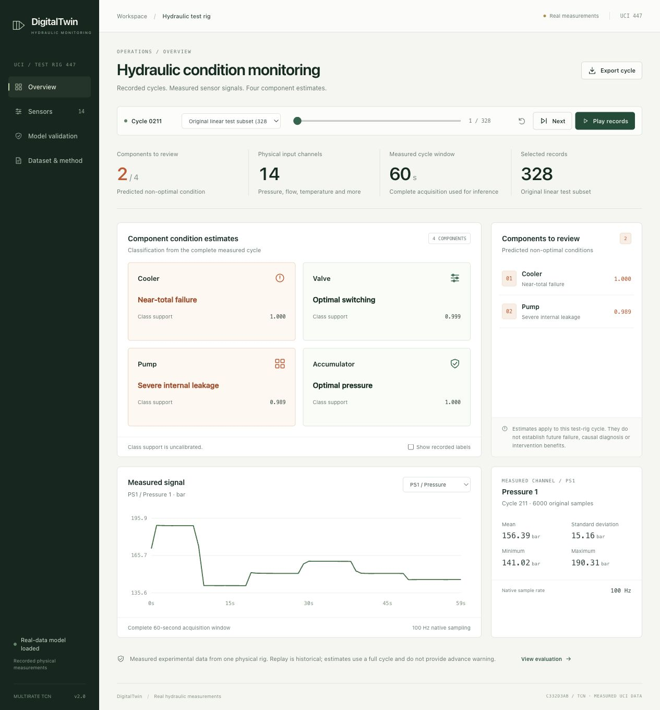
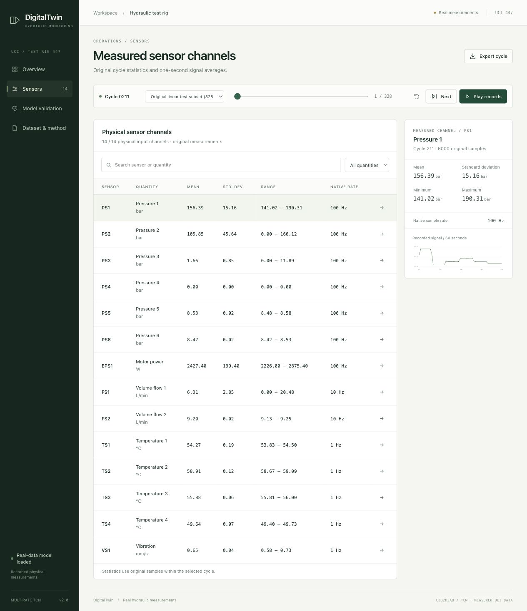
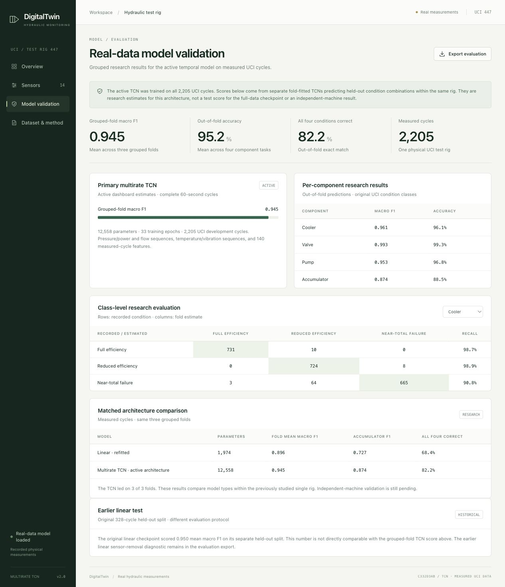
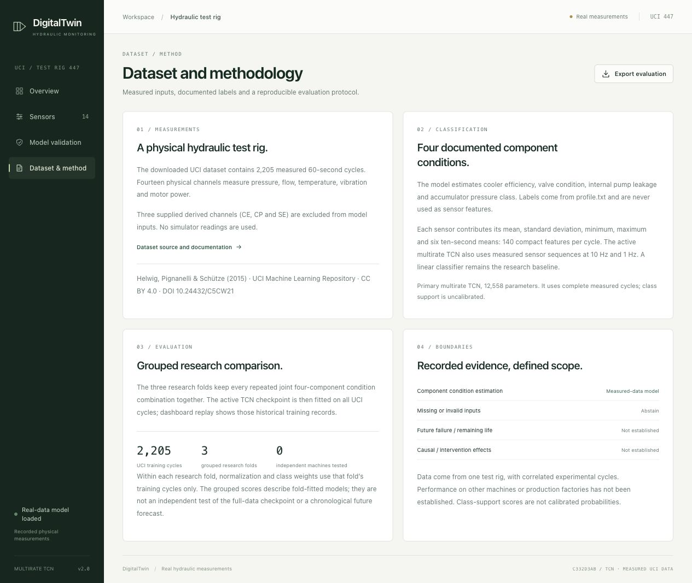
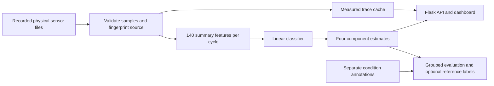

<div align="center">

# DigitalTwinAI

**Hydraulic condition monitoring from real sensor measurements.**

Replay recorded cycles, inspect physical signals, and evaluate four component conditions in a local research dashboard.

[](model.py)
[](app.py)
[](hydraulics.py)
[](static/dashboard.js)
[](#quick-start)

[Dashboard preview](#dashboard-preview) · [Quick start](#quick-start) · [Model results](#model-results) · [How it works](#how-it-works) · [Independent evaluation](#independent-recording-evaluation) · [Roadmap](UPGRADES.md)

</div>

DigitalTwinAI turns the UCI hydraulic test-rig recordings into an inspectable condition-monitoring application. The dashboard combines measured traces, component estimates, historical replay, and reproducible evaluation. It runs locally with three Python dependencies.

| Measurements | Inputs | Predictions | Active model |
|---|---|---|---|
| **2,205** recorded cycles | **14** physical channels | **4** component conditions | **1,974** parameter linear classifier |
| 60 seconds per cycle | Pressure, flow, temperature, power, vibration | Cooler, valve, pump, accumulator | 140 sensor summary features |

> **Research status:** The deployed linear model scores **0.950 mean component macro F1** on its original grouped test split. A compact TCN achieved **0.9449** in a separate three-fold comparison. These protocols differ; their headline scores cannot be directly ranked. Independent-machine validation is still pending.

## Dashboard preview

Actual application captures from **4 November 2026**, with the trained linear checkpoint loaded. The overview and sensor views show source cycle **211**, the first record in the held-out test partition. Click a screenshot to view it at full size.

[](docs/screenshots/overview.jpg)

<details>
<summary><strong>Explore the sensor page</strong> — channel search, filters and measured traces</summary>

Inspect all 14 physical inputs, their units and native sample rates. Select a channel to inspect its cycle statistics and recorded trace.

[](docs/screenshots/sensors.jpg)

</details>

<details>
<summary><strong>Explore model validation</strong> — component scores, confusion matrices and TCN research</summary>

The page presents the deployed model's results, channel-removal sensitivity, and a separately labeled experimental TCN comparison.

[](docs/screenshots/validation.jpg)

</details>

<details>
<summary><strong>Explore dataset & method</strong> — provenance, preprocessing and evaluation boundaries</summary>

Source attribution, input definitions, grouped splitting and research limitations are available inside the application.

[](docs/screenshots/methodology.jpg)

</details>

## Quick start

**Already set up this checkout?** Run this from the project directory:

```bash
.venv/bin/python app.py
```

Open **[http://127.0.0.1:5001](http://127.0.0.1:5001)**. The dashboard starts at the first held-out test record. Replay navigates historical measurements; it is not a live equipment connection.

<details>
<summary><strong>First-time setup on macOS / Linux</strong></summary>

You need Python 3 with a compatible PyTorch build, pip, and the original UCI download. The extracted sensor text occupies about 531 MB. Processing streams the files one row at a time, then reuses compact caches.

**1. Clone and install**

```bash
git clone https://github.com/Piyush314159/DigitalTwinAI.git
cd DigitalTwinAI
python3 -m venv .venv
.venv/bin/python -m pip install -r requirements.txt
```

**2. Add the real measurements**

Download and extract [Condition monitoring of hydraulic systems from UCI](https://archive.ics.uci.edu/dataset/447/condition+monitoring+of+hydraulic+systems) under `data/`:

```text
data/
└── condition+monitoring+of+hydraulic+systems/
    ├── profile.txt
    ├── PS1.txt … PS6.txt
    ├── EPS1.txt
    ├── FS1.txt … FS2.txt
    ├── TS1.txt … TS4.txt
    └── VS1.txt
```

Keep the original download intact. Preparation locates the single complete set of sensor files under `data/`. To use another location, set the directory containing those `.txt` files before training or starting the app:

```bash
export HYDRAULICS_DATA_DIR="/absolute/path/to/extracted/files"
```

**3. Train and generate the sensitivity report**

```bash
.venv/bin/python -m scripts.train_hydraulics
.venv/bin/python -m scripts.evaluate_robustness
```

Training saves the active checkpoint and evaluation artifacts in `training_outputs/`. Downloaded data, generated caches and model checkpoints are excluded from Git, so a fresh clone needs this step. The optional TCN experiment has its own [command below](#experimental-multirate-tcn).

**4. Start the dashboard**

```bash
.venv/bin/python app.py
```

Open [http://127.0.0.1:5001](http://127.0.0.1:5001). Restart the application after retraining so it loads the new checkpoint. CPU execution is supported; the application runs without an external service or API key.

</details>

<details>
<summary><strong>Windows command equivalents</strong></summary>

After cloning and placing the downloaded data as above, run these commands from the project directory:

```powershell
py -m venv .venv
.venv\Scripts\python.exe -m pip install -r requirements.txt
.venv\Scripts\python.exe -m scripts.train_hydraulics
.venv\Scripts\python.exe -m scripts.evaluate_robustness
.venv\Scripts\python.exe app.py
```

For data stored elsewhere, set `$env:HYDRAULICS_DATA_DIR = "C:\path\to\extracted\files"` in the same PowerShell session. Then open [http://127.0.0.1:5001](http://127.0.0.1:5001).

</details>

## Explore the application

| Page / control | What you can do |
|---|---|
| **Overview** | Review four condition estimates, flagged components, a selectable measured signal, and cycle statistics. |
| **Sensors** | Search or filter physical channels and inspect their original-sample statistics and recorded traces. |
| **Model validation** | Inspect component scores, switch confusion matrices, examine sensor sensitivity and read the experimental TCN comparison. |
| **Dataset & method** | Review data attribution, model inputs, evaluation protocol and limitations. |
| **Cycle replay** | Play, pause, step, reset or seek within test, validation, training or all recorded cycles. Each tab keeps its own selection. |
| **Recorded labels** | Opt in to reference annotations displayed separately from model estimates. Labels are excluded from inference. |
| **Exports** | Download the selected cycle's sensor statistics and predictions as CSV, or the saved evaluation as JSON. |

Try this short walkthrough: choose a test cycle, inspect **PS1** and **FS1**, enable **Show recorded labels**, then open **Model validation** and select **Accumulator** in the confusion matrix. This connects individual predictions with the task's measured weaknesses.

## Model results

### Deployed linear classifier

All cycles sharing a joint four-component condition combination stay in one partition. Seed 42 assigns the 144 combinations to **86 training / 29 validation / 29 test groups**, containing **1,371 / 506 / 328 cycles**. Scaling and class weights use training cycles only; validation selects the training checkpoint.

| Original held-out test | Cooler | Valve | Pump | Accumulator | Mean macro F1 |
|---|---:|---:|---:|---:|---:|
| Linear classifier | 1.000 | 0.935 | 0.996 | 0.869 | **0.950** |

Mean component accuracy is **94.97%**; all four conditions are correct together on **80.49%** of test cycles. Macro F1 averages class F1 scores within each task, then averages the four tasks equally. The accumulator is the weakest task.

Inspect the [training report](training_outputs/training_report.md), [exact metrics](training_outputs/metrics.json), and [split manifest](training_outputs/split_manifest.json). This is a same-rig test of unseen condition combinations. The dataset does not supply independent run identifiers or absolute recording timestamps.

### Experimental multirate TCN

```bash
.venv/bin/python -m scripts.compare_tcn
```

The **12,558 parameter** TCN combines sensor sequences at two rates with the same 140 summary features. It uses two residual temporal blocks and runs on CPU with two threads. The saved run took about **261 seconds of TCN fitting**; raw-data preparation and other steps add overhead.

Both architectures train from scratch on the **same three outer grouped folds**. An inner grouped split chooses each training length before refitting on the complete outer training fold.

| Matched three-fold comparison | Fold mean macro F1 | Out-of-fold accumulator F1 | All four correct |
|---|---:|---:|---:|
| Linear, refitted | 0.8957 | 0.7266 | 68.39% |
| Multirate TCN | **0.9449** | **0.8739** | **82.22%** |

TCN led on all three folds. Much of the improvement came from fold 3, where inner validation chose only 24 linear training epochs. A **post-hoc diagnostic** trained linear for 250 epochs on each fold and reached **0.9156** fold mean macro F1. TCN still led, but that diagnostic followed inspection of the first results and is exploratory.

These folds reuse the previously studied rig. **The TCN is a research candidate; dashboard estimates use the linear checkpoint.** Its 0.9449 cross-validation result cannot be directly ranked against the deployed model's original 0.950 test score. See the [TCN report](training_outputs/tcn_experiment/report.md), [frozen protocol](training_outputs/tcn_experiment/protocol.json), and [longer-trained linear diagnostic](training_outputs/tcn_experiment/linear_250_diagnostic.json).

<details>
<summary><strong>Earlier candidates and sensor sensitivity</strong></summary>

A small MLP, nearest-cycle accumulator classifier, one-layer GRU, boosted trees and an earlier two-block CNN were evaluated. None established an improvement over its matched linear baseline. Their integrations and generated experiment files were removed; [UPGRADES.md](UPGRADES.md) retains their scores and protocol differences.

The sensor-removal diagnostic removes one channel's feature block from held-out cycles and substitutes training means while keeping model weights fixed. It measures model sensitivity to artificial channel removal. Its [report](training_outputs/robustness/report.md) and [exact results](training_outputs/robustness/metrics.json) are saved separately.

For actual dashboard estimates, incomplete cycles cause the application to withhold predictions. The diagnostic's imputation policy is not used silently for displayed estimates.

</details>

## Independent recording evaluation

Two **frozen comparison candidates** can now be fitted on all 2,205 UCI development cycles. TCN training length is the median (33 epochs) of its three saved inner-fold choices; linear uses the stronger 250-epoch diagnostic setting. Both use the same training cycles. This leaves the active dashboard checkpoint untouched. The checkpoints and any later external results are local generated artifacts, ignored by Git.

<details>
<summary><strong>Prepare candidates and evaluate new recordings</strong> — commands, file format and provenance</summary>

```bash
.venv/bin/python -m scripts.external_validation prepare
```

The resulting checkpoints and hashes are in `training_outputs/external_validation/`. To evaluate a genuinely new collection, place it in a separate directory with `profile.txt`, the same 14 physical sensor filenames listed above, and `metadata.json`. Each line of a sensor file is one **complete 60-second cycle** in profile-row order: 6,000 samples for PS1–PS6 and EPS1, 600 for FS1–FS2, and 60 for TS1–TS4 and VS1. Values must use the documented physical units and comparable sensor placement. `profile.txt` has four condition-code columns in cooler/valve/pump/accumulator order, with an optional fifth stability flag. The code values must match `hydraulics.py`.

Example provenance file (replace every value with the actual collection details):

```json
{
  "source_id": "new-collection-id",
  "machine_id": "new-machine-id",
  "collection_period": "recorded dates or run IDs",
  "independence_basis": "different_machine",
  "label_provenance": "how component conditions were verified",
  "sensor_alignment": "how sensor positions, units and sample rates match UCI"
}
```

`independence_basis` can also be `later_collection` for a separately documented later run. The evaluator checks file shapes, condition codes, all class coverage, finite measurements, frozen checkpoint hashes and exact overlap with UCI training cycles. It never trains on the new recordings. Source and machine identity are declared by the provider and still need human verification.

```bash
.venv/bin/python -m scripts.external_validation evaluate /absolute/path/to/new-recordings
```

This writes an immutable JSON report, readable report and exact predictions in `training_outputs/external_validation/evaluations/`. Both candidates are scored on the **same new cycles**. The present project contains no independently collected compatible recordings, so it has no external score yet. Other public machinery datasets use different channels or fault definitions and cannot be substituted into this four-component test without changing the task.

</details>

## How it works



Each sensor contributes its mean, standard deviation, minimum, maximum and six consecutive ten-second means. These statistics use native samples; dashboard traces show one-second averages. Raw files are streamed and hashed, and caches are checked against their source fingerprint. The app checks checkpoint and report identity before presenting saved model metrics.

The TCN uses pressure and power block averages at **10 Hz**, native **10 Hz** flow, and native **1 Hz** temperature and vibration, plus the summary features. Reducing 100 Hz signals by block averaging can lose high-frequency transients.

### Dataset and attribution

Source: **Helwig, N., Pignanelli, E. & Schütze, A. (2015). _Condition monitoring of hydraulic systems_. UCI Machine Learning Repository.** [Dataset documentation](https://archive.ics.uci.edu/dataset/447/condition+monitoring+of+hydraulic+systems) · [DOI: 10.24432/C5CW21](https://doi.org/10.24432/C5CW21) · Dataset license: **[CC BY 4.0](https://creativecommons.org/licenses/by/4.0/)**.

| Physical inputs | Quantity | Native rate | Unit |
|---|---|---:|---|
| PS1–PS6 | Pressure | 100 Hz | bar |
| EPS1 | Motor power | 100 Hz | W |
| FS1–FS2 | Volume flow | 10 Hz | L/min |
| TS1–TS4 | Temperature | 1 Hz | °C |
| VS1 | Vibration | 1 Hz | mm/s |

The supplied derived channels **CE, CP and SE** are excluded from model inputs. `profile.txt` provides four condition targets and a steady-state flag; these annotations stay separate from sensor features. Original downloaded files are preserved, with hashes recorded in the [source manifest](training_outputs/source_manifest.json).

## Reproduce and inspect

| Task | Command / artifact |
|---|---|
| Train the active linear model | `.venv/bin/python -m scripts.train_hydraulics` |
| Generate channel sensitivity results | `.venv/bin/python -m scripts.evaluate_robustness` |
| Run the optional TCN comparison | `.venv/bin/python -m scripts.compare_tcn` |
| Freeze external evaluation candidates | `.venv/bin/python -m scripts.external_validation prepare` |
| Score compatible new recordings | `.venv/bin/python -m scripts.external_validation evaluate /absolute/path/to/new-recordings` |
| Active checkpoint | `training_outputs/model.pt` — generated locally, ignored by Git |
| Exact test predictions | `training_outputs/test_predictions.npz` |
| Exact TCN comparison predictions | `training_outputs/tcn_experiment/out_of_fold_predictions.npz` |

<details>
<summary><strong>Run the verification checks</strong></summary>

```bash
.venv/bin/python -B -m unittest discover -s tests -v
node --test tests/test_dashboard.cjs
```

Python checks require the dataset and trained evaluation artifacts; the TCN checks also need its completed experiment. Node is needed only for the JavaScript checks. The dashboard itself uses the Python environment.

Checks cover raw-to-cache alignment, grouped split isolation, training-only normalization, checkpoint reload, exact metric reproduction, label exclusion, missing-data handling, replay selection, and matching exports. JavaScript checks exercise chart gaps and record-selection behavior with Node's built-in test runner.

</details>

<details>
<summary><strong>API reference and record selection</strong></summary>

| Method | Route | Purpose |
|---|---|---|
| GET | `/api/config` | Sensor metadata, component classes, partitions and model status |
| GET | `/api/state` | Selected cycle's measured readings and condition estimates |
| POST | `/api/step` · `/api/seek` · `/api/reset` | Navigate historical records |
| POST | `/api/partition` | Select a partition, starting at its first record |
| GET | `/api/reference` | Explicitly requested recorded condition annotations |
| GET | `/api/validation` | Saved model evaluation and available research results |
| GET | `/api/snapshot.csv` | Selected cycle's measurements and predictions |
| GET | `/api/evaluation.json` | Download the saved evaluation |

GET requests select a record with `partition` and zero-based `position`, for example `/api/state?partition=test&position=7`. Use the same selection for reference labels and CSV exports. Replay POST requests carry the selection in a JSON body; `/api/step` advances from the supplied position. Requests without a selection start at the first record of the default partition.

Invalid or incomplete readings become JSON `null`, gaps in charts, and empty CSV cells. The app withholds all condition estimates for that cycle. A missing checkpoint makes estimates unavailable; a missing or mismatched evaluation report makes its metrics unavailable.

</details>

<details>
<summary><strong>Project layout</strong></summary>

```text
DigitalTwinAI/
├── app.py                      # Dashboard and record-selection API
├── hydraulics.py               # Data preparation, provenance, splitting and metrics
├── model.py                    # Active linear classifier
├── scripts/
│   ├── train_hydraulics.py      # Real-data training and evaluation
│   ├── evaluate_robustness.py   # Frozen-model channel sensitivity
│   ├── compare_tcn.py           # Optional multirate TCN experiment
│   └── external_validation.py   # Frozen candidates and new-recording evaluation
├── templates/                  # Dashboard HTML
├── static/                     # CSS and browser interactions
├── docs/screenshots/            # Actual dashboard captures used in this README
├── tests/                      # Python and JavaScript checks
├── data/                       # Original download and rebuildable caches
├── training_outputs/           # Checkpoint, reports, splits and exact predictions
├── papers/                     # Historical proposal material
├── requirements.txt
└── UPGRADES.md                 # Experiment history and future work
```

</details>

<details>
<summary><strong>Troubleshooting</strong></summary>

| Symptom | What to check |
|---|---|
| Dataset cannot be found | Extract the download; ensure `profile.txt` and all 14 physical-channel files share one directory. Set `HYDRAULICS_DATA_DIR` if needed. |
| Estimates are unavailable | Run the linear training command to create `training_outputs/model.pt`, then restart the app. |
| Dataset/checkpoint mismatch | Confirm the intended raw files, then retrain and regenerate the sensitivity report before restarting. |
| Sensitivity or TCN panel is absent | Generate that experiment locally. The TCN panel also checks its source cache, protocol and prediction hashes. |
| Port 5001 is occupied | Run `.venv/bin/python -m flask --app app run --host 127.0.0.1 --port 5002`, then open `http://127.0.0.1:5002`. |
| Python or JavaScript checks fail on a fresh clone | Prepare the dataset and required model/experiment artifacts; install Node for the JavaScript checks. |

</details>

## Scope and next steps

This application classifies a **complete 60-second recorded cycle**. Class-support scores are uncalibrated. The current evidence comes from one rig with correlated cycles; performance on another machine, future failure warning, remaining useful life and causal intervention effects have not been established. Historical proposals in `papers/` describe earlier ideas, rather than validation of the present system.

The next evaluation needs compatible, labeled recordings from another machine or an independently documented collection run. Freeze both models and their preprocessing before examining those recordings, then compare them on the same new cycles. Further work and completed upgrades are tracked in [UPGRADES.md](UPGRADES.md).

[Back to top](#digitaltwinai)
