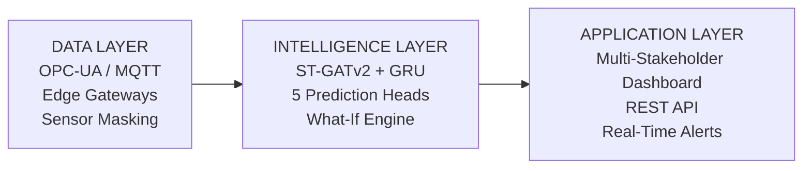
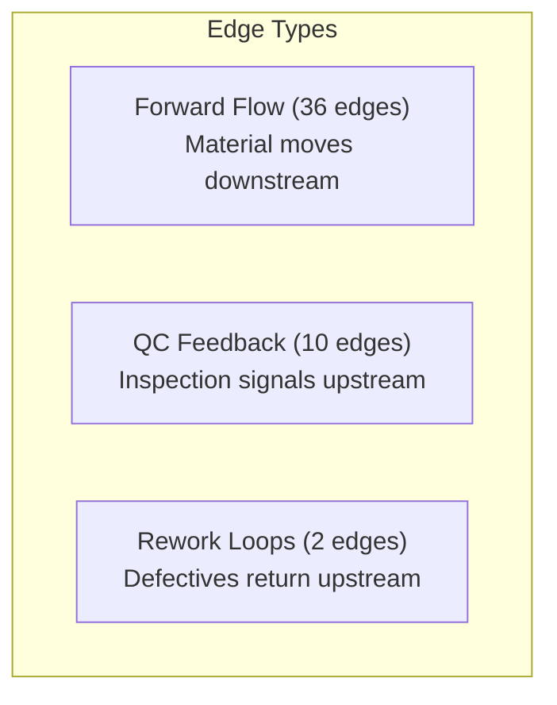

# DigitalTwin.ai — Project Overview

> **Accenture Innovation Challenge 2026 — Round 2 Prototype**
> **Author:** Piyush Maji

---

## 🎯 What Is It?

**DigitalTwin.ai** is a **Spatio-Temporal Graph Intelligence** system for vehicle assembly lines. It models an entire 40-station production line as a **dynamic directed graph** — stations are nodes, material/information flows are edges — powered by a **Spatio-Temporal Graph Neural Network (ST-GNN)**.

---

## 🏗️ Architecture (3-Layer)

---

## 📊 Node Features (12 per Station)

Each of the 40 stations (nodes) has **12 input features** that represent its real-time operational state:

| # | Feature | Unit | Description | Always Observable? |
|---|---------|------|-------------|-------------------|
| 0 | `queue_length` | count | Number of units waiting at the station | ✅ Yes (visual count) |
| 1 | `cycle_time` | seconds | Actual processing time per unit (×takt) | ✅ Yes (PLC/manual) |
| 2 | `defect_rate` | % | Rate of quality defects at the station | ✅ Yes (inspection records) |
| 3 | `temperature` | °C | Station/process temperature | ⚠️ FULL & PARTIAL only |
| 4 | `vibration` | mm/s | Vibration measurement from equipment | 🔴 FULL only |
| 5 | `torque_deviation` | % | Deviation from target torque | 🔴 FULL only |
| 6 | `utilization` | % | Equipment uptime percentage | ✅ Yes |
| 7 | `throughput` | fraction | Output as fraction of target | ✅ Yes |
| 8 | `humidity` | % | Ambient humidity (critical in paint zone) | ⚠️ FULL & PARTIAL only |
| 9 | `power_draw` | kW | Electrical power consumption | 🔴 FULL only |
| 10 | `hrs_since_maint` | hours | Hours since last maintenance window | ✅ Yes (logs) |
| 11 | `operator_skill` | index 0–1 | Operator experience/training level | ✅ Yes (HR records) |

### Instrumentation Levels & Feature Observability

| Level | % of Stations | Features Available | Missing (must be inferred by GNN) |
|-------|--------------|-------------------|----------------------------------|
| **FULL** | 60% (24 stations) | All 12 | None |
| **PARTIAL** | 25% (10 stations) | 9 of 12 | vibration, torque_deviation, power_draw |
| **MANUAL** | 15% (6 stations) | 8 of 12 | temperature, vibration, torque_deviation, humidity |

---

## 🏭 40-Station Graph: 3 Production Zones

### Zone A — Body Construction (13 stations, IDs 0–12)

| ID | Station | Short | Instrumentation | Vintage | Takt (s) |
|----|---------|-------|-----------------|---------|----------|
| 0 | Blanking Press | BLANK | FULL | Modern | 45 |
| 1 | Stamping Press A | STMP-A | FULL | Modern | 52 |
| 2 | Stamping Press B | STMP-B | FULL | **Legacy** | 55 |
| 3 | Laser Cutting | LASER | FULL | Modern | 38 |
| 4 | Hemming Station | HEM | **PARTIAL** | **Legacy** | 60 |
| 5 | Spot Weld Cell 1 | WELD-1 | FULL | Modern | 48 |
| 6 | Spot Weld Cell 2 | WELD-2 | FULL | Modern | 48 |
| 7 | Spot Weld Cell 3 | WELD-3 | **PARTIAL** | **Legacy** | 55 |
| 8 | Adhesive Bonding | BOND | **PARTIAL** | **Legacy** | 42 |
| 9 | Geometry Check | GEO | FULL | Modern | 35 |
| 10 | BiW Audit | BIW-AUD | **MANUAL** | **Legacy** | 90 |
| 11 | Sealer Application | SEAL | **PARTIAL** | **Legacy** | 50 |
| 12 | Underbody Coating | UCOAT | FULL | Modern | 40 |

### Zone B — Paint Shop (11 stations, IDs 13–23)

| ID | Station | Short | Instrumentation | Vintage | Takt (s) |
|----|---------|-------|-----------------|---------|----------|
| 13 | Pretreatment Bath | PRETR | FULL | Modern | 120 |
| 14 | E-Coat Dip Tank | ECOAT | FULL | Modern | 180 |
| 15 | E-Coat Cure Oven | EC-CURE | FULL | Modern | 200 |
| 16 | Seam Seal Booth | SEAM | **PARTIAL** | **Legacy** | 65 |
| 17 | Primer Spray Booth | PRIMER | FULL | Modern | 55 |
| 18 | Primer Cure Oven | PR-CURE | **PARTIAL** | **Legacy** | 180 |
| 19 | Color Spray Booth | COLOR | FULL | Modern | 60 |
| 20 | Color Cure Oven | CL-CURE | FULL | Modern | 180 |
| 21 | Clear Coat Booth | CLEAR | FULL | Modern | 55 |
| 22 | Clear Cure Oven | CC-CURE | **PARTIAL** | **Legacy** | 180 |
| 23 | Paint Inspection | P-INSP | **MANUAL** | **Legacy** | 120 |

### Zone C — Final Assembly (16 stations, IDs 24–39)

| ID | Station | Short | Instrumentation | Vintage | Takt (s) |
|----|---------|-------|-----------------|---------|----------|
| 24 | Wiring Harness | WIRE | **MANUAL** | **Legacy** | 95 |
| 25 | Dashboard Install | DASH | **PARTIAL** | **Legacy** | 110 |
| 26 | Headliner Install | HEAD | **MANUAL** | **Legacy** | 75 |
| 27 | Door Trim Assembly | DTRIM | **MANUAL** | **Legacy** | 85 |
| 28 | Glass Installation | GLASS | FULL | Modern | 70 |
| 29 | Seat Installation | SEAT | FULL | Modern | 65 |
| 30 | Chassis Marriage | MARRY | FULL | Modern | 80 |
| 31 | Engine/Motor Drop | ENGN | FULL | Modern | 90 |
| 32 | Suspension Torque | SUSP | FULL | Modern | 70 |
| 33 | Brake Line Connect | BRAKE | **PARTIAL** | **Legacy** | 55 |
| 34 | Fluid Fill Station | FLUID | FULL | Modern | 50 |
| 35 | Wheel Mounting | WHEEL | FULL | Modern | 45 |
| 36 | Battery/Fuel System | BATT | FULL | Modern | 60 |
| 37 | Final Torque Audit | TORQ-A | FULL | Modern | 55 |
| 38 | ADAS Calibration | ADAS | FULL | Modern | 120 |
| 39 | Roll Test & Dispatch | ROLL | **MANUAL** | **Legacy** | 180 |

---

## 🔗 Graph Topology (48 Edges)

| Edge Type | Count | Purpose | Example |
|-----------|-------|---------|---------|
| **Forward flow** | 36 | Material moves station to station | Blanking → Stamping A |
| **QC Feedback** | 10 | Inspection results flow upstream | Geometry Check → Weld Cells |
| **Rework** | 2 | Failed units re-enter upstream | BiW Audit fail → Spot Weld 1 |

---

## 🧠 What We Used for What

### Model Architecture — [model.py](file:///Users/piyushmaji/Desktop/accentureInnovation/model.py)

| Component | Technology | Purpose |
|-----------|-----------|---------|
| **GATv2Conv** (4 attention heads) | PyTorch Geometric | **Spatial reasoning** — learns which neighboring stations influence each other via graph attention. Captures station-to-station dependencies across the assembly line |
| **GRU Cell** (per node) | PyTorch | **Temporal reasoning** — captures time-series dynamics at each station (shift ramp-up, degradation, break patterns) |
| **3 × Spatio-Temporal Blocks** | Custom | Stacked GATv2+GRU blocks for deep spatial-temporal feature extraction |
| **Input Projection** (Linear → ELU → LayerNorm) | PyTorch | Maps 12 raw features → 128-dim hidden space |
| **LayerNorm + Residual Connections** | PyTorch | Training stability and gradient flow |

### 5 Prediction Heads — What Each Does

| Head | Type | Output | What It Tells You |
|------|------|--------|-------------------|
| **Queue Forecast** | Regression | `[40, 1]` | Predicted queue build-up at each station — warns of bottlenecks 10–15 min ahead |
| **Defect Risk** | 3-class classification | `[40, 3]` (LOW/MEDIUM/HIGH) | Risk of defect propagation at each station |
| **Virtual Sensor** | Feature reconstruction | `[40, 12]` | Infers missing sensor readings for PARTIAL/MANUAL stations via neighbor aggregation |
| **Anomaly Score** | Binary probability | `[40, 1]` (0–1) | Real-time anomaly detection per station |
| **Root-Cause Attribution** | Attention weights | Per-edge weights | Identifies *which upstream station* is the root cause of downstream issues |

### Confidence Head

| Component | Purpose |
|-----------|---------|
| **Confidence Score** | Outputs per-node confidence (0–1). FULL-instrumented stations get ~0.90 base, PARTIAL ~0.65, MANUAL ~0.35. Flags when virtual sensor predictions are unreliable. |

### Simulator — [simulator.py](file:///Users/piyushmaji/Desktop/accentureInnovation/simulator.py)

| Component | Purpose |
|-----------|---------|
| **Normal Baseline Generation** | Generates realistic telemetry per station within defined operating ranges |
| **Temporal Dynamics** | Simulates shift ramp-up (first 10%), break period (~40–45%), end-of-shift fatigue (last 15%) |
| **Anomaly Injection** | 5 built-in multi-causal scenarios injected at configurable time steps |
| **Cascade Propagation** | BFS up to 3 hops downstream — anomalous stations affect neighbors with attenuated signals |
| **Sensor Masking** | Zeros-out unobservable features for PARTIAL/MANUAL stations, forcing the GNN to infer them |

### Web Dashboard — [app.py](file:///Users/piyushmaji/Desktop/accentureInnovation/app.py) + [dashboard.js](file:///Users/piyushmaji/Desktop/accentureInnovation/static/dashboard.js)

| Component | Technology | Purpose |
|-----------|-----------|---------|
| **Backend** | Flask (Python) | REST API serving predictions, timeline, what-if results, validation metrics |
| **Frontend** | Vanilla JS + CSS | Interactive multi-stakeholder dashboard with 3 views |
| **What-If Engine** | `model.simulate_intervention()` | Clones node features → applies hypothetical changes → re-runs GNN → shows predicted downstream impact |

---

## 🚨 5 Built-In Anomaly Scenarios

| # | Scenario | Category | Station(s) | Onset Step | Severity | What Happens |
|---|----------|----------|-----------|------------|----------|-------------|
| 1 | Weld Gun Electrode Wear | Equipment | WELD-3 (ID 7) | Step 5 | 0.7 | Vibration ↑, cycle time ↑, defects ↑ — detected downstream at Geometry Check |
| 2 | Paint Booth Humidity | Environmental | COLOR, CLEAR (19, 21) | Step 8 | 0.6 | Temperature ↑, humidity ↑ → orange peel & fish-eye defects |
| 3 | Stamping Die Wear | Equipment | STMP-B (ID 2) | Step 3 | 0.5 | Dimensional drift propagates through welding stations |
| 4 | Shift Change Operator Drop | Operator | WIRE, DASH, HEAD, DTRIM (24–27) | Step 15 | 0.4 | Skill ↓, cycle time ↑, defects ↑, queues ↑ |
| 5 | Upstream Part Quality | Supply Chain | BOND (ID 8) | Step 10 | 0.6 | Defect rate ↑, queue ↑, torque deviation ↑ |

---

## 📊 Three Stakeholder Views

| View | Target User | Key Panels |
|------|------------|------------|
| **Floor Supervisor** | Real-time operator | Live assembly graph (color-coded risk), active alerts, station status matrix, virtual sensing panel |
| **Plant Manager** | Shift planner | Shift KPIs, risk heatmap (station × time), bottleneck frequency chart, what-if simulator, anomaly tracker |
| **Leadership** | Executives | ROI projections, model validation metrics (precision/recall/F1), multi-plant rollout plan, implementation roadmap |

---

## 🎯 Outcomes & Business Impact

| Metric | Expected Improvement |
|--------|---------------------|
| **Unplanned Downtime** | 30–45% reduction |
| **Rework Costs** | 25–35% reduction |
| **Bottleneck Detection** | From reactive → **10–15 min advance warning** |
| **Sensor Hardware Costs** | 40–60% reduction via virtual sensing |
| **Annual Savings (per plant)** | **$2.8M–$4.5M** |
| **Pilot Payback Period** | ~6–9 months |

### Technical Validation Metrics (Live)

The dashboard computes these against simulator ground truth in real-time:
- **Precision** — How many flagged anomalies are real
- **Recall** — How many real anomalies are caught
- **F1 Score** — Harmonic mean of precision and recall
- **False Alarm Rate** — Fraction of false positives

---

## 🛠️ Tech Stack Summary

| Layer | Technology | Why |
|-------|-----------|-----|
| **Deep Learning** | PyTorch 2.0+ | Industry-standard DL framework, GPU support |
| **Graph Neural Networks** | PyTorch Geometric (GATv2Conv) | State-of-the-art graph attention for spatial dependencies |
| **Graph Construction** | NetworkX | Building & analyzing directed graph topology |
| **Data Simulation** | NumPy | Fast numerical computation for synthetic telemetry |
| **Web Backend** | Flask | Lightweight Python web server for REST API |
| **Web Frontend** | Vanilla JS + CSS | Interactive dashboard with no framework overhead |
| **Visualization** | Matplotlib | Static demo visualizations (4 output PNGs) |

---

## 📁 File Map

| File | Role | Lines |
|------|------|-------|
| [`model.py`](file:///Users/piyushmaji/Desktop/accentureInnovation/model.py) | ST-GATv2 + GRU neural network with 5 prediction heads | 279 |
| [`assembly_line.py`](file:///Users/piyushmaji/Desktop/accentureInnovation/assembly_line.py) | 40-station definition, graph topology, sensor masks | 411 |
| [`simulator.py`](file:///Users/piyushmaji/Desktop/accentureInnovation/simulator.py) | Synthetic telemetry generation + anomaly injection | 350 |
| [`app.py`](file:///Users/piyushmaji/Desktop/accentureInnovation/app.py) | Flask backend — inference engine + REST API | 381 |
| [`demo.py`](file:///Users/piyushmaji/Desktop/accentureInnovation/demo.py) | Standalone terminal demo with 4 visualizations | 893 |
| [`templates/index.html`](file:///Users/piyushmaji/Desktop/accentureInnovation/templates/index.html) | Dashboard SPA template | — |
| [`static/dashboard.js`](file:///Users/piyushmaji/Desktop/accentureInnovation/static/dashboard.js) | Frontend logic (graph, KPIs, charts) | — |
| [`static/style.css`](file:///Users/piyushmaji/Desktop/accentureInnovation/static/style.css) | Dark-themed dashboard styling | — |
